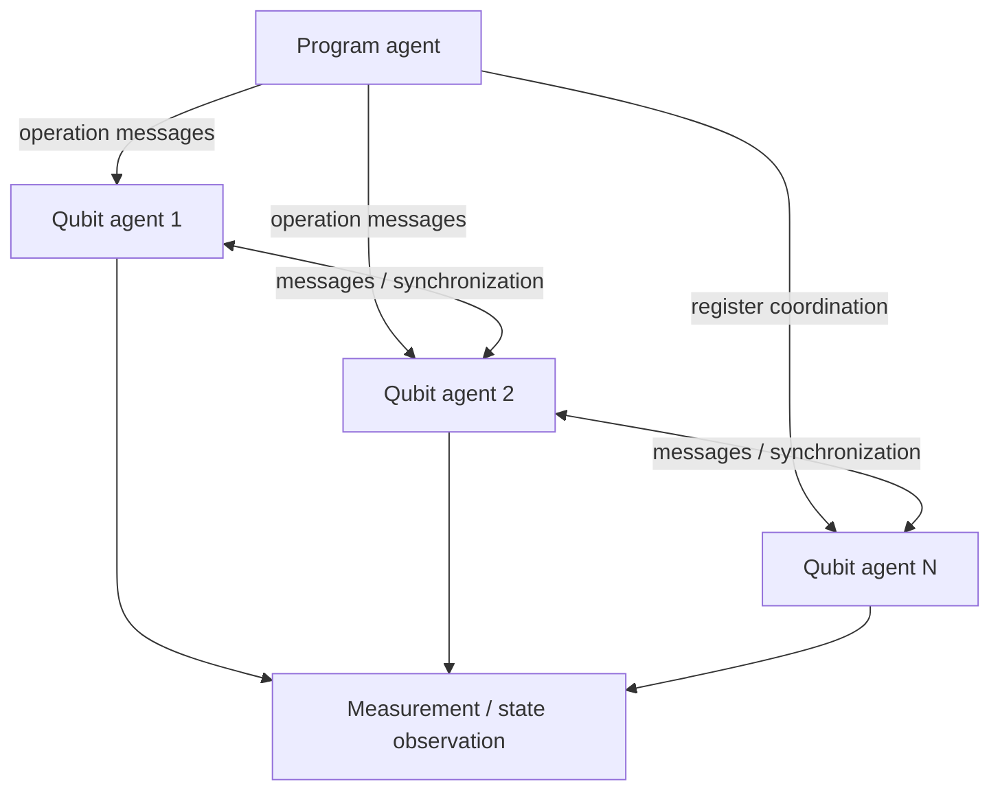

# Quantum Multi-Agent Simulator

> **Research prototype · C++ · Multi-agent systems · Quantum computing**

An experimental exploration of **quantum computing through autonomous agents**. Rather than treating a quantum register only as a monolithic data structure, this project models individual qubits as agents with their own state and behaviour. Quantum operations and register-level coordination are expressed through messages exchanged between these agents.

The central research angle is architectural: **how can quantum-state operations be distributed across autonomous components, and how can those components coordinate to represent operations on a quantum register?** The implementation uses a multi-agent approach to explore this question, with qubit agents responding to typed messages for operations such as X, H, measurement and decoherence.

This code was developed as part of a research internship/project during a Master's degree in Computer Science at **Université de Bretagne Occidentale (UBO), France**. The source archive was supplied as a historical snapshot; the repository preserves that implementation rather than presenting it as a maintained, production-ready simulator.

## Research focus

The project is primarily an exploration of an agent-based architecture for representing quantum systems. Its key idea is to make each qubit an autonomous agent and use message passing as the coordination mechanism between qubits and the program-level component.

Within this architecture, the implementation explores selected quantum-computing concepts:

- **Qubit agents** with probability amplitudes/probabilities and state tracking (`QuBit`).
- **Quantum operations** including Pauli-X, Hadamard, controlled operations and Grover-oracle handling.
- **Measurement** and register-state handling.
- **Decoherence**, represented as an explicit simulation behaviour.
- **Agent communication**, using typed messages for operations such as X, H, Grover, measurement and decoherence.

The archived examples include programs for Grover search, qubit entanglement and decoherence. These are exploratory demonstrations, not a claim of a complete or physically validated quantum simulator.

## Architecture at a glance

`QuBit` instances are modelled as agents rather than passive entries in a single register object. `Prog` coordinates a collection of these agents, while typed messages carry operation requests and related events. This makes agent autonomy and inter-agent communication the defining architectural choices of the prototype. The underlying agent runtime is provided by an external dependency (see [Dependencies](#dependencies)).

## Repository contents

| File(s) | Purpose |
|---|---|
| `QuBit.h`, `QuBit.cpp` | Qubit-agent state and behaviour |
| `Prog.h`, `Prog.cpp` | Program/register coordination and quantum operations |
| `Prog1.*`, `Prog2.*` | Specialized program variants used by examples |
| `Message*.h`, `Message*.cpp` | Typed messages for quantum operations and events |
| `GroverAlgorithm.cpp` | Grover-algorithm demonstration |
| `intricationExample.cpp` | Entanglement demonstration |
| `decoherenceExample.cpp` | Decoherence demonstration |
| `*.mk` | Historical makefiles for the example executables |

## Dependencies

The original makefiles expect an external multi-agent framework under a directory named `GestionAgents/LibMoRis`, with headers such as `MAS.h` and `Agent.h`, and a static library named `libAgents.a`. **That dependency is not included in this repository.**

## Build status

The original makefiles are preserved as historical build metadata, but they contain machine-specific relative paths and require the missing external framework. Consequently, a reproducible build cannot currently be documented. No claim is made that this snapshot builds with a modern toolchain.

Once the original framework and a compatible compiler/toolchain are available, the makefiles indicate the intended targets:

- `GroverAlgorithm`
- `intricationExample`
- `decoherenceExample`

## Historical context

- **Institution:** Université de Bretagne Occidentale (UBO)
- **Programme:** Master's degree in Computer Science
- **Context:** Research internship/project
- **Development period:** 2020 (as provided for this archive)
- **Repository publication:** 2026
- **Status:** Archived research prototype; build and behaviour not revalidated

## Scope and limitations

This repository is intended to document an academic exploration of multi-agent modelling for quantum-computing concepts. It should not be used as a reference implementation for quantum algorithms or as a substitute for established quantum-computing frameworks. The numerical model, concurrency semantics and physical validity have not been independently re-assessed.

